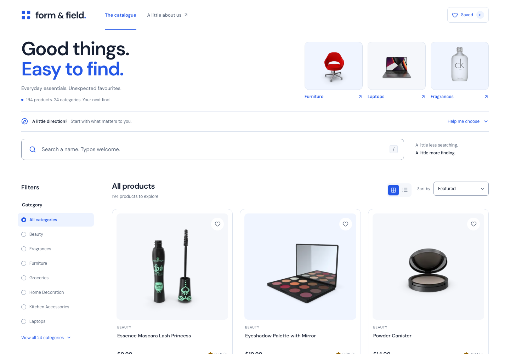
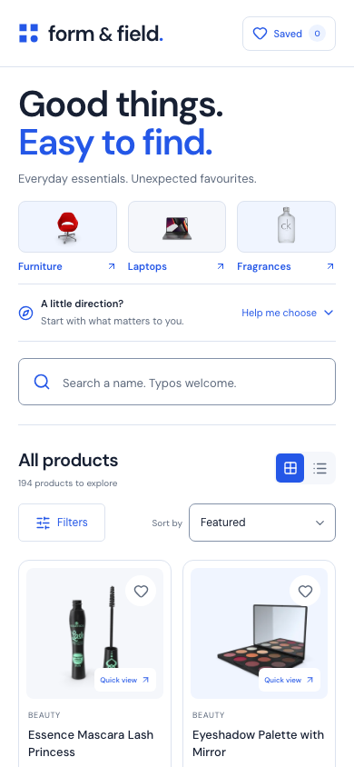
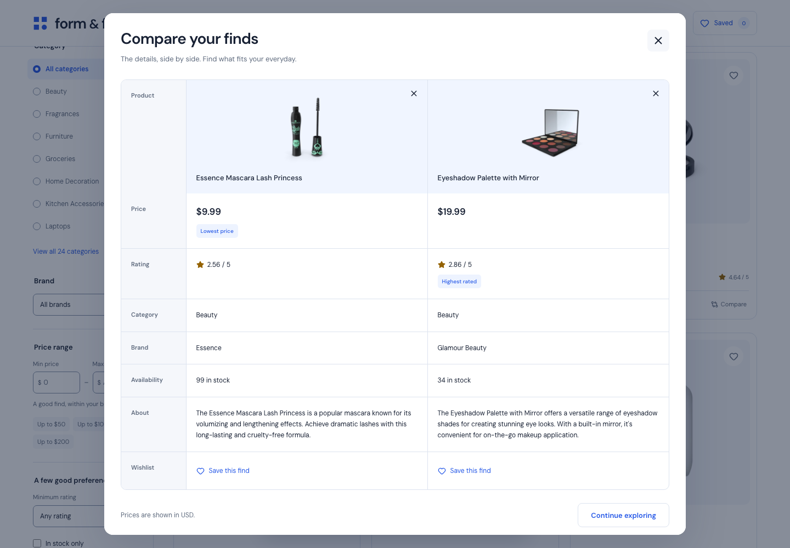
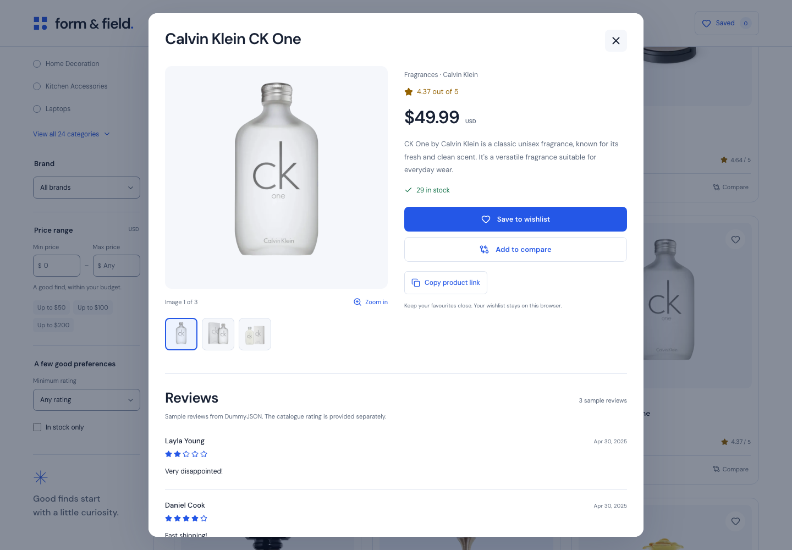
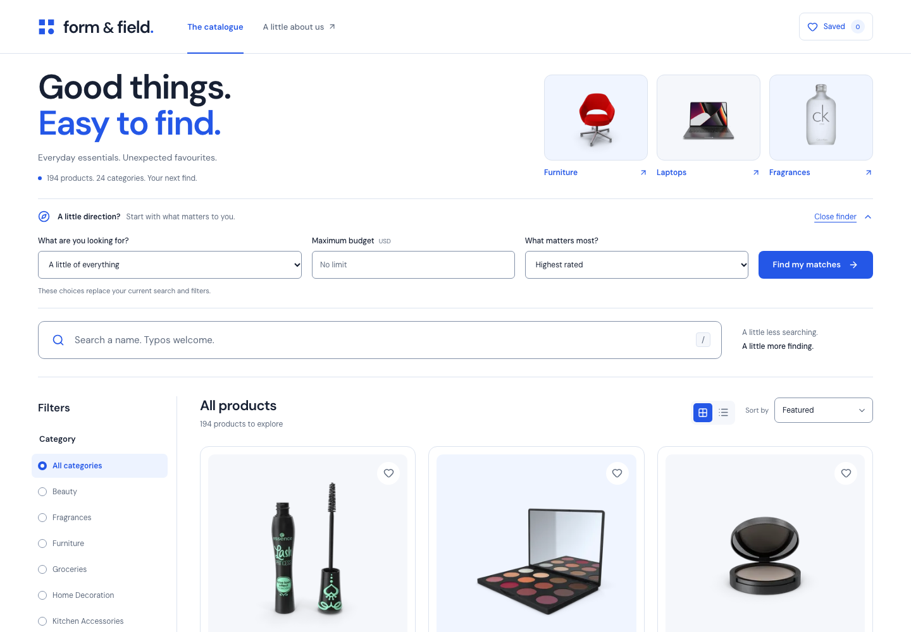

# Form & Field

A responsive, single-page product catalogue built to help people find the right item quickly. Search and filters work together, while product details, saved finds, and side-by-side comparison help people decide without leaving the page.

**Stack:** React, TypeScript, Vite, CSS, Vitest, and Playwright.

## Submission links

- [Public GitHub repository](https://github.com/paidadharshitha/form-and-field)
- [Live catalogue](https://paidadharshitha.github.io/form-and-field/)





<details>
<summary>View the product comparison</summary>



</details>

<details>
<summary>View the product gallery and reviews</summary>



</details>

<details>
<summary>View the guided product finder</summary>



</details>

## Run locally

Use Node.js 24 and npm. No API key, environment variables, or backend setup are required.

```sh
npm ci
npm run dev
```

Open the local URL printed by Vite. The catalogue needs internet access to load products and their images from DummyJSON.

```sh
npm run build    # Type-check and create the production build in dist/
npm run preview  # Serve the production build locally
npm test         # Run the unit tests once
npm run format:check # Check consistent source formatting
```

For browser tests, install Playwright's Chromium browser once, then run the suite:

```sh
npx playwright install chromium
npm run test:e2e
```

## Using the catalogue

- **Smart search:** name suggestions appear as you type and respect active filters. Use the arrow keys and Enter to select a suggestion, or tap it. Escape dismisses suggestions; pressing it again clears the search. Matching ignores case and surrounding whitespace. If there are no exact name matches, conservative typo matching offers close results with an explicit notice.
- **Search highlights:** matching letters are highlighted in product names and suggestions. The original title stays intact; typo-corrected letters are not presented as exact matches.
- **Guided finder:** choose **Help me choose**, select a category, maximum budget, and priority (highest rating or lowest price), then apply the shortlist. The form explains that these choices replace the current search and filters.
- **Category:** choose one category, browse all products, or use the illustrated category shortcuts. Shortcuts update the category while preserving your other filters.
- **Brand:** choose a brand from the supplied catalogue data. The same selector is available in the desktop sidebar and phone filter sheet, and the active brand can be removed individually.
- **Price:** optional minimum and maximum prices, including both endpoints. Blank fields leave that end unrestricted. Invalid or reversed ranges show a helpful validation message.
- **Rating and availability:** narrow the collection to ratings of 4+ or 4.5+, and optionally show only products with stock available.
- **Sort:** featured order, price low to high or high to low, and rating high to low or low to high. Equal values use product ID as a deterministic tie-breaker. Featured preserves the API's original order.
- **Combined filters:** every active condition must match. Removing a filter or clearing all filters restores results immediately.
- **Smart empty results:** when nothing matches, one-click suggestions relax only filters that actually unlock results. The interface explains the change and previews the resulting match count. A full reset remains available.
- **Shareable filters:** `q`, `category`, `brand`, `min`, `max`, `rating`, `stock`, and `sort` are reflected in the URL. For example, `?rating=4.5&stock=1&sort=price-asc` shows available products rated at least 4.5, cheapest first. Unsupported rating values are ignored.
- **Progressive display:** 24 matching products appear initially; load more to see the next group. Filtering always searches the full collection, including products not yet displayed.
- **Grid or list:** switch between image-led cards and a list with product descriptions while keeping the current filters and sort.
- **Quick view:** open a product's image or title to inspect its description, brand when supplied, price, rating, and availability in a dialog.
- **Product links:** **Copy product link** shares a URL with `product=<id>`, preserving current filters and the deployment path. Opening that link loads the product's details directly. Closing details removes the product parameter while keeping filters. If clipboard access is unavailable, a selectable link appears instead of a false success message.
- **Reviews:** quick view displays the API's sample reviews, with reviewer name, date, rating, and comment. They are labeled as sample data; the catalogue rating is supplied separately. Reviewer email addresses are discarded during parsing and never displayed.
- **Image gallery and zoom:** browse supplied product photos in quick view and zoom in for detail. Products with a single image still support zoom; missing galleries use the thumbnail.
- **Recently viewed:** the last eight products you opened appear below the catalogue, newest first. Reopening a product moves it to the front. History survives reloads on this browser and can be cleared with one action.
- **Similar products:** quick view offers up to four alternatives in the same category and within 50% of the current product's price, ordered by the closest price. Opening an alternative stays in the same dialog.
- **Wishlist:** save products using the heart, then open **Saved** to search and filter those finds. Saved IDs stay in this browser and synchronize across tabs.
- **Undo:** removing a saved item or clearing viewing history offers an Undo action. It stays available until dismissed, used, or replaced by the next removal/clear action. Undo also works inside product and comparison dialogs.
- **Comparison:** select up to three products, then choose **Compare** in the floating tray to review their details side by side. Products can be removed or saved from the comparison.

Desktop puts filters in a persistent sidebar. Phones use the same filter controls inside a native dialog, with an explicit close action and keyboard dismissal. Quick view and comparison also stay on the same page. Loading, empty results, an empty wishlist, invalid prices, and request failures each have a distinct state.

## Decisions and trade-offs

### Fetch the whole catalogue, then filter locally

[DummyJSON's products endpoint](https://dummyjson.com/docs/products) returns only 30 items by default. The application requests `limit=0` and selects the fields it needs, so searching and filtering cover the entire catalogue. Categories are derived from the returned data rather than maintained as a separate list.

For a few hundred items, a single fetch and a local filter/sort pipeline keep interactions immediate and make combined conditions straightforward. This deliberately avoids server requests on every keystroke. For a much larger catalogue, I would move filtering, sorting, and pagination to an API with matching semantics, plus request cancellation and caching.

Search first checks exact normalized substrings across the current collection (all products or Saved). Typo matching runs only if that collection has no exact match. It checks each query word against title words, allowing one edit for words of 4–7 characters and two for words of at least 8, with at most two edits total. Short words and model numbers require exact matching. Category, brand, budget, rating, and stock conditions then narrow those matches. This keeps filters strict and avoids replacing excluded exact matches with unrelated suggestions. It is a small deterministic local matcher, without a search service or a large fuzzy-search dependency.

Similar products use catalogue data: the same category and a price range from 50% to 150% of the viewed price. Ties use higher rating, then product ID. Zero-priced items only suggest other zero-priced items. The section is omitted when no suitable alternatives exist. Gallery URLs are included in the initial metadata request, while the selected photo and thumbnails load when needed.

The guided finder is a transparent shortcut into the same filter/sort pipeline. Empty-state suggestions test the smallest filter changes first, return at most three useful alternatives, and combine changes only when no single relaxation works. Their counts are computed from the same full collection being browsed, including the Saved collection when it is active. Highlighted text is rendered as React text nodes rather than injected HTML.

### Keep state and business rules small

React owns the interface state without an additional state-management library. `src/lib/catalogue.ts` contains the shared product types, response validation, category derivation, price validation, and pure filtering/sorting functions. Components render those results rather than duplicating the selection logic. The desktop and mobile interfaces share the same filter component.

Product cards, category shortcuts, comparison, suggestions, and compact product strips reuse `ProductImage`, including its missing-image fallback. Quick view's gallery handles photo selection, zoom, and recovery to the product thumbnail when a detailed photo fails. Quick view and comparison share a native-dialog wrapper for focus containment, keyboard dismissal, and returning focus when the dialog closes. Similar and recently viewed products share one strip component; price and availability formatting are shared helpers.

External JSON is validated before rendering. Fetch errors are visible and retryable; there is no hardcoded fallback catalogue that could disguise an unavailable data source. Products and images therefore remain dependent on DummyJSON's availability.

### Keep personal choices local

The wishlist stores only product IDs in `localStorage` under `form-field:saved-products:v1`; it does not copy product records or create an account. Stored IDs are validated and deduplicated before use. Corrupt data is handled safely. When browser storage is unavailable or a write fails, saving continues in memory for the current visit and the interface explains that limitation. Saved products do not sync between browsers or devices.

Recently viewed uses a separate `form-field:recently-viewed:v1` key, also storing only validated IDs. It keeps at most eight entries and writes only after an explicit product open or history-clear action. Unavailable storage falls back to the current visit. Products no longer present in the catalogue are not displayed. This history is local to the browser and does not provide cross-device or simultaneous-tab synchronization.

Undo holds only the most recent reversible removal in memory and does not survive a reload. Restoring a saved item adds that ID without replacing later changes. Restoring cleared history merges it behind products viewed since the clear, removes duplicates, and retains the eight-item limit. Feedback has no timeout, so keyboard and assistive-technology users have time to act.

The comparison is intentionally temporary, with a maximum of three products to keep the table readable. It resets on reload. Grid/list selection and the Saved view are also session UI choices; shared URLs preserve filters and sorting, not private saved IDs or comparison selections.

### Make the catalogue easy to scan

The user-selected visual direction pairs a clean white canvas with cobalt blue actions, slate text, and self-hosted DM Sans typography. Shared color tokens keep cards, forms, dialogs, feedback, and focus states consistent. Product images, names, prices, and ratings lead the card hierarchy. Category shortcuts and the collapsible guided finder provide entry points without hiding search. Labels, native form controls, dialogs, and responsive spacing support keyboard and small-screen use. The comparison table scrolls within its own region on phones. Images load lazily where appropriate, and showing products in groups limits the initial DOM and image workload.

Prices use **USD as a display assumption**: the API provides a numeric price without an explicit currency field. Prices are shown directly from the API; the application does not calculate an additional discount.

Quick view shows supplied catalogue metadata. Comparison labels such as **Lowest price** and **Highest rated** describe only the currently selected products, and appear only when there is a unique best value. Missing brands are labeled as unspecified.

### Stay within the task

This is a catalogue, not a checkout flow. There is no cart, account, payment integration, or invented shipping promise. The focus is accurate discovery and a polished experience on phones and laptops.

## Verification

The automated checks focus on behavior: combining filters, inclusive price and rating boundaries, availability, exact-first typo matching, deterministic sorting, response validation, gallery URLs, related-product budgets, stored-ID validation, recovery suggestions, safe highlighting, and product links. Browser tests exercise desktop and mobile, including finder validation, filter recovery, copied links and clipboard fallback, direct-link loading, sample reviews, undo inside and outside dialogs, search, history, gallery, comparison, and layout selection. They use controlled API responses so failures can be reproduced without depending on the live dataset changing.

Verified locally: **141 unit tests**, **81 browser tests**, and **2 live API smoke tests** pass. The browser suite includes automated axe checks of the catalogue, search suggestions, filters, finder, recovery, feedback, reviews, gallery, zoom, quick view, and comparison against WCAG A/AA rules; these checks report no violations. Automated checks complement keyboard and visual review; they do not constitute comprehensive accessibility certification.

The normal browser run skips the live API tests and the phone-only dialog test on desktop. To run the live smoke checks (which also capture desktop and mobile screenshots):

```sh
LIVE_SMOKE=1 npx playwright test tests/live-smoke.spec.ts
```

Useful manual checks:

1. Combine a name, category, and price range; change the sort and confirm all conditions remain active.
2. Enter a name with no matches, then clear the filters.
3. Set the minimum above the maximum and check the validation message.
4. Open a filtered URL in another tab and confirm the view is restored.
5. On a phone-sized viewport, open the filters, change a value, close the dialog, and continue browsing.
6. Block the products request, check the error state, then restore the connection and retry.
7. Save a product, reload, and confirm it remains in Saved; repeat with storage disabled to check the session-only message.
8. Compare three products, confirm a fourth cannot be added, then remove one and add another.
9. Open and close quick view with the keyboard; switch between grid and list while filters are active.
10. Search for `lipstik`, select a suggestion with the arrow keys and Enter, then combine a brand and budget.
11. Open a product with multiple photos, switch images, and zoom; try the gallery on a phone as well.
12. Open a similar product, close the dialog, and reopen it from Recently viewed. Reload to check history, then clear it.
13. Use Help me choose with a category, budget, and priority; confirm it replaces the previous filters as described.
14. Create an empty result with a restrictive brand or price, then try a suggested adjustment and check that other filters remain.
15. Copy a product link, open it in another tab, and confirm the product opens directly. Close details and check that the filters remain.
16. Remove a saved item and Undo it. Clear recent history, open another product, then Undo the clear and check that both the newer and restored history remain.

## Deployment

The repository includes `.github/workflows/deploy.yml`. A push to `main`, or a manual workflow run, installs the locked dependencies, runs the unit, browser, and accessibility tests, builds the application, and deploys `dist/` to GitHub Pages. Build and deploy jobs have separate permissions; only deployment can write Pages and request an identity token. Concurrent deployments are serialized.

For a fork, enable **Settings → Pages → Source → GitHub Actions**, then run the workflow. Vite uses a relative asset base, so the build works beneath a GitHub Pages repository path. The output is also a static `dist/` folder that can be hosted on Vercel or Netlify with `npm run build` as the build command.

No secrets belong in this client application. Any future private API integration would need a server-side boundary.
